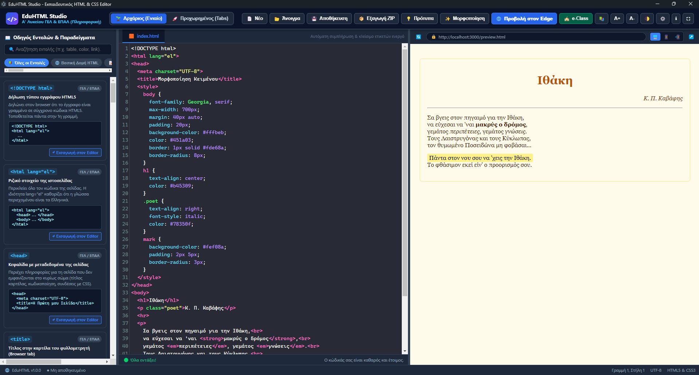

# EduHTML Studio 🎓 (Windows 11 Edition)

**Εκπαιδευτικός HTML5 & CSS3 Editor με Ενσωματωμένο Browser για την Α' Λυκείου (ΓΕΛ) & τον Τομέα Πληροφορικής των ΕΠΑΛ**

[](https://creativecommons.org/licenses/by-nc/4.0/)
[](https://www.microsoft.com/windows)
[](https://www.electronjs.org/)

> **Δημιουργός:** **Λέων Προκόπης**, Καθηγητής Πληροφορικής ΠΕ86, 2ο ΓΕΛ Ναυπλίου  
> **Σχεδιασμένο & Βελτιστοποιημένο:** Αποκλειστικά για περιβάλλοντα Windows 11 σχολικών εργαστηρίων και οικιακών υπολογιστών.

---

## 📸 Προεπισκόπηση Εφαρμογής



---

## 📖 Περιγραφή & Σκοπός

Το **EduHTML Studio** αναπτύχθηκε για να καλύψει τις ανάγκες διδασκαλίας και εργαστηριακής εξάσκησης των μαθητών της Δευτεροβάθμιας Εκπαίδευσης:
- **Α' Τάξη Γενικού Λυκείου (ΓΕΛ):** Μάθημα «Εφαρμογές Πληροφορικής» (Εισαγωγή στις γλώσσες σήμανσης HTML5).
- **Τομέας Πληροφορικής ΕΠΑΛ:** Ειδικότητες Πληροφορικής (Μαθήματα «Σχεδίαση & Ανάπτυξη Ιστοτόπων», HTML5, CSS3, Responsive Design).

Στόχος του λογισμικού είναι να παρέχει ένα **ολοκληρωμένο, εύχρηστο και ασφαλές offline περιβάλλον**, χωρίς περίπλοκες ρυθμίσεις ή απαιτήσεις δικτύου.

---

## 📥 Έτοιμες Εκδόσεις για Λήψη (Windows 11)

Τα έτοιμα εκτελέσιμα αρχεία της έκδοσης **v1.9.0** είναι διαθέσιμα στις [Κυκλοφορίες (GitHub Releases)](https://github.com/pliroforikos/myHTML/releases):

| Έκδοση | Αρχείο | Χαρακτηριστικά & Χρήση |
| :--- | :--- | :--- |
| 🚀 **Portable (Φορητή)** | **[`EduHTML.Studio-Portable-1.9.0.exe`](https://github.com/pliroforikos/myHTML/releases/download/v1.9.0/EduHTML.Studio-Portable-1.9.0.exe)** | Αυτόνομο αρχείο `.exe` που εκτελείται άμεσα **χωρίς εγκατάσταση** και χωρίς δικαιώματα διαχειριστή. Ιδανικό για **USB Flash Drive** στα σχολικά εργαστήρια. |
| 💿 **Setup (Εγκατάσταση)** | **[`EduHTML.Studio-Setup-1.9.0.exe`](https://github.com/pliroforikos/myHTML/releases/download/v1.9.0/EduHTML.Studio-Setup-1.9.0.exe)** | Πλήρης εγκαταστάτης Windows (NSIS) με δημιουργία συντομεύσεων στην Επιφάνεια Εργασίας και το Μενού Έναρξης. |
| 🏫 **MSI (Μαζική Εγκατάσταση)** | **[`EduHTML.Studio-1.9.0.msi`](https://github.com/pliroforikos/myHTML/releases/download/v1.9.0/EduHTML.Studio-1.9.0.msi)** | Πακέτο Windows Installer για **όλους τους χρήστες** του υπολογιστή (Program Files). Εγκαθίσταται σιωπηλά, ιδανικό για μαζική διανομή στο εργαστήριο (GPO, Intune, PDQ Deploy, σενάριο εντολών). |

🔄 **Ενημέρωση μέσα από την εφαρμογή:** από την έκδοση 1.7.0 η εφαρμογή ελέγχει μόνη της για νέα έκδοση και την κατεβάζει/εγκαθιστά με ένα κλικ (Setup: αυτόματη εγκατάσταση, Portable: λήψη και εκκίνηση της νέας, MSI: σελίδα λήψης). Δες το [INSTALL.md, ενότητα 5](INSTALL.md).

📖 **Αναλυτικός Οδηγός Εγκατάστασης:** [`INSTALL.md`](INSTALL.md) (μεμονωμένοι υπολογιστές, μαζική εγκατάσταση, Group Policy, Intune, αναβάθμιση, απεγκατάσταση, αντιμετώπιση προβλημάτων).

### 🏫 Μαζική Εγκατάσταση στο Εργαστήριο (MSI)

Από γραμμή εντολών **ως διαχειριστής** σε κάθε υπολογιστή (ή μέσω εργαλείου απομακρυσμένης διανομής):

```bat
:: Σιωπηλή εγκατάσταση για όλους τους χρήστες
msiexec /i "EduHTML.Studio-1.9.0.msi" /qn /norestart

:: Σιωπηλή εγκατάσταση με αρχείο καταγραφής (για διάγνωση προβλημάτων)
msiexec /i "EduHTML.Studio-1.9.0.msi" /qn /norestart /l*v "%TEMP%\eduhtml-install.log"

:: Σιωπηλή απεγκατάσταση
msiexec /x "EduHTML.Studio-1.9.0.msi" /qn /norestart
```

- **Group Policy (GPO):** Αντιγράψτε το `.msi` σε κοινόχρηστο φάκελο δικτύου και προσθέστε το στο *Computer Configuration → Policies → Software Settings → Software installation*.
- **Αναβαθμίσεις:** Κάθε νέα έκδοση MSI αντικαθιστά αυτόματα την προηγούμενη (σταθερό UpgradeCode), χωρίς να χρειάζεται πρώτα απεγκατάσταση.
- Οι ρυθμίσεις και οι φάκελοι εργασιών (`Έγγραφα\mywebpages`) παραμένουν ξεχωριστοί για κάθε μαθητικό λογαριασμό.

> 💡 **Σημείωση:** Για άμεση εκτέλεση από τον πηγαίο κώδικα, αρκεί ένα διπλό κλικ στο αρχείο **[`start.bat`](start.bat)**.

---

## ✨ Κύριες Δυνατότητες & Χαρακτηριστικά

### 1. 🪟 Ειδικές Βελτιστοποιήσεις για Windows 11
- **Ενσωμάτωση Microsoft Edge (`msedge.exe`):** Άμεση κλήση του προεγκατεστημένου Edge των Windows 11 για 100% πιστή προβολή.
- **Windows 11 Fluent UI & Styling:** Υποστήριξη Mica effect, σκοτεινού/φωτεινού θέματος, Windows Snap Layouts (`Win + Βέλη`) και σύγχρονων γραμματοσειρών (`Segoe UI Variable`, `Cascadia Code`).
- **Αποθήκευση:** στο ribbon (καρτέλα «Κεντρικό») τα κουμπιά **Αποθήκευση** (Ctrl+S) και **Αποθήκευση ως…** (Ctrl+Shift+S)· η γραμμή κατάστασης δείχνει αν υπάρχουν μη αποθηκευμένες αλλαγές.
- **Δουλεύει πάντα στο ανοιχτό αρχείο:** η καρτέλα του editor και ο τίτλος του παραθύρου δείχνουν το όνομα του αρχείου (π.χ. `askisi.html`) και η μπάρα της προεπισκόπησης τη διαδρομή του. Η **Προβολή στον Browser** αποθηκεύει και ανοίγει το ίδιο το αρχείο (στη λειτουργία «Προχωρημένος» αποθηκεύει και το CSS)· μια σελίδα που δεν έχει αποθηκευτεί ακόμα ζητά πρώτα όνομα.
- **Πολλά αρχεία σε καρτέλες:** κάθε αρχείο που ανοίγει (ή κάθε «Νέο») μπαίνει σε δική του καρτέλα· ένα αρχείο που είναι ήδη ανοιχτό δεν ανοίγει δεύτερη φορά. Η **προεπισκόπηση δείχνει πάντα το αρχείο με το focus** (με focus σε CSS, την τελευταία σελίδα HTML με αυτό το CSS). Τελεία στην καρτέλα = μη αποθηκευμένες αλλαγές· κλείσιμο με ✕, μεσαίο κλικ ή **Ctrl+W** (ρωτά αν υπάρχουν αλλαγές), εναλλαγή με **Ctrl+Tab**. Στη λειτουργία «Αρχάριος» φαίνονται μόνο οι καρτέλες HTML.
- **Σύνδεση HTML ↔ CSS (Προχωρημένος):** η προεπισκόπηση εφαρμόζει το CSS **μόνο μέσω του `<link rel="stylesheet" href="…">`** της σελίδας, όπως ένας browser: ένα αρχείο CSS ανοιχτό σε καρτέλα δίνει το περιεχόμενό του (και τις αλλαγές που δεν έχουν αποθηκευτεί), αλλιώς φορτώνεται από τον δίσκο. Η μπάρα ελέγχου προειδοποιεί όταν η σελίδα δεν συνδέεται με CSS ή όταν το `href` δείχνει σε αρχείο που δεν υπάρχει· το κουμπί **«Σύνδεση με CSS»** (και το δεξί κλικ) προσθέτει τη γραμμή `<link>` στο `<head>`.
- **Εισαγωγή εικόνας (``):** κουμπί **Εικόνα** στο ribbon, στο δεξί κλικ, στο μενού Επεξεργασία (**Ctrl+Shift+P**) και στην κάρτα `` του Οδηγού Εντολών. Ο μαθητής διαλέγει την εικόνα από τον διάλογο των Windows και η διαδρομή μπαίνει μέσα στα `""` του `src`:
  - Αν ο κέρσορας είναι μέσα σε ένα ``, συμπληρώνεται το `src` του· αλλιώς μπαίνει ολόκληρη η ετικέτα `` με τον κέρσορα μέσα στο `alt`.
  - **Ίδιος φάκελος με τη σελίδα:** μόνο το όνομα (`eikona.jpg`). **Υποφάκελος:** σχετική διαδρομή (`images/eikona.jpg`). **Αλλού:** ολόκληρη η διαδρομή (`file:///C:/Φωτο/eikona.jpg`) και σχετική ειδοποίηση, γιατί αυτή δουλεύει μόνο σε αυτόν τον υπολογιστή.
- **Θέματα & Χρώμα Κεφαλίδας (όπως στο myGlossa):** 8 θέματα — τα προεπιλεγμένα **Φωτεινό / Σκοτεινό** και θέματα τύπου Android Studio (**Dark, Darcula, Islands Darcula, Light, IntelliJ Light, Islands Light**). Επιλογή από το ribbon, από το μενού **Προβολή → Θέμα εμφάνισης** ή από τις Ρυθμίσεις· εναλλαγή φωτεινό ↔ σκοτεινό με **Ctrl+Shift+T**. Η γραμμή τίτλου, οι καρτέλες και το ribbon έχουν **ένα χρώμα** (Ρυθμίσεις: «Ίδιο με το θέμα», 13 έτοιμα χρώματα ή οποιοδήποτε άλλο) με προαιρετική **διαβάθμιση (gradient)** δύο χρωμάτων και κατεύθυνση. Τα γράμματα και τα κουμπιά του παραθύρου προσαρμόζονται μόνα τους ώστε να διαβάζονται.
- **Πλήρης Οθόνη & Ελαχιστοποίηση:** Ειδικό κουμπί πλήρους οθόνης (`⛶`) και συμβατότητα με τις γνωστές λειτουργίες παραθύρου των Windows 11.
- **Μενού με Καρτέλες (Ribbon):** Οι ενέργειες είναι οργανωμένες σε καρτέλες, ώστε η οθόνη να μένει καθαρή:
  - **🏠 Κεντρικό:** Νέο, Άνοιγμα, Αποθήκευση, Αποθήκευση ως · Προβολή στον Browser · Οδηγός Εντολών, Μορφοποίηση · Εισαγωγή εικόνας
  - **🎒 Εργασία:** Πρότυπα · Εξαγωγή ZIP, e-Class
  - **🎨 Εμφάνιση:** Μέγεθος γραμμάτων · Θέμα (εναλλαγή φωτεινό/σκοτεινό και επιλογή θέματος) · Χρώμα κεφαλίδας · Πλήρης Οθόνη
  - **⚙️ Ρυθμίσεις & Βοήθεια:** Ρυθμίσεις · Συντομεύσεις, Σχετικά

### 2. 🌱 Διπλή Λειτουργία Εργασίας (Modes)
- **🌱 Λειτουργία Αρχάριος (Ενιαίο Αρχείο):** Ο μαθητής γράφει ένα ενιαίο `index.html` με ενσωματωμένο εσωτερικό CSS (`<style>...</style>`). Ιδανικό για τα πρώτα εισαγωγικά μαθήματα.
- **🚀 Λειτουργία Προχωρημένος (Multi-Tab):** Διαχωρισμένες καρτέλες για `index.html` και `style.css` με αυτόματη συνένωση κατά την εκτέλεση.
- **Προσαρμογή Διεπαφής:** Από τις Ρυθμίσεις (`⚙️`), ο καθηγητής μπορεί να αποκρύψει τα κουμπιά επιλογής λειτουργίας και τα πρότυπα, προσφέροντας μια υπεραπλουστευμένη οθόνη για αρχάριους μαθητές.

### 3. 💡 Έξυπνη Πρόταση Εντολών HTML & CSS (Autocomplete στυλ Notepad++)
- **Αυτόματη Εμφάνιση Προτάσεων:** Καθώς ο μαθητής ανοίγει ένα tag (πληκτρολογώντας `<`) ή ξεκινά τη δακτυλογράφηση, εμφανίζεται αυτόματα αναδυόμενο παράθυρο με καθαρά ονόματα ετικετών HTML5 (π.χ. `h1`, `p`, `a`, `table`, `img` κ.ά.) με το χαρακτηριστικό εικονίδιο του Notepad++.
- **Αυτόματο Κλείσιμο Ετικετών & Τοποθέτηση Κέρσορα:** Με την επιλογή οποιασδήποτε διπλής ετικέτας, τοποθετείται αυτόματα το ζεύγος (π.χ. `<h1></h1>`) και ο κέρσορας τοποθετείται αυτόματα στο κέντρο για άμεση πληκτρολόγηση.
- **Υποστήριξη CSS:** Στην καρτέλα `style.css` (ή στο εσωτερικό CSS), προτείνονται αυτόματα όλες οι ιδιότητες CSS (π.χ. `color`, `background-color`, `font-size`, `display` κ.ά.).
- **Συντόμευση Πληκτρολογίου:** Άμεση εμφάνιση προτάσεων ανά πάσα στιγμή με `Ctrl + Space` ή `Alt + Space`.

### 4. 🌐 Ενσωματωμένος & Εξωτερικός Browser
- **Live Preview:** Άμεση ανανέωση της ιστοσελίδας σε πραγματικό χρόνο καθώς πληκτρολογεί ο μαθητής.
- **Επιλογή Εξωτερικού Browser:** Δυνατότητα ορισμού του αγαπημένου browser από τις Ρυθμίσεις (**Edge**, **Chrome**, **Firefox**, **Brave** ή Windows Default). Το κουμπί προσαρμόζεται αυτόματα (π.χ. *«Προβολή στον Edge»*).
- **Σύνδεση με το e-Class (`🏫 e-Class`):** Άμεσο κουμπί για άνοιγμα της επίσημης πύλης **`https://eclass.sch.gr`** του Πανελλήνιου Σχολικού Δικτύου.

### 5. 📁 Οργάνωση Αρχείων & Αυτόματος Φάκελος
- **Αυτόματος Φάκελος `Documents/mywebpages`:** Στην πρώτη εκκίνηση δημιουργείται αυτόματα φάκελος στα Έγγραφα του χρήστη.
- **Άνοιγμα & Αποθήκευση:** Οι διάλογοι αρχείων ανοίγουν απευθείας στον προεπιλεγμένο φάκελο, διευκολύνοντας τους μαθητές στην εύρεση των εργασιών τους.
- **Δυνατότητα Αλλαγής:** Ο φάκελος αλλάζει ανά πάσα στιγμή μέσα από τις Ρυθμίσεις (`⚙️`).
- **Καθαρός Σκελετός στο «📄 Νέο»:** Το κουμπί «Νέο» παράγει έναν καθαρό βασικό σκελετό (`<!DOCTYPE html>`, `<html>`, `<head>`, `<title>`, `<body>`) χωρίς περιττά στοιχεία.

### 6. 📖 Διαδραστικός Οδηγός Εντολών (Cheat Sheet) στα Ελληνικά
- Πλήρης κατάλογος όλων των ετικετών HTML5, ιδιοτήτων CSS3 και βασικών εντολών JavaScript του αναλυτικού προγράμματος.
- Επεξηγήσεις στα απλά Ελληνικά, σύνταξη, έτοιμα παραδείγματα και ένδειξη επιπέδου (ΓΕΛ / ΕΠΑΛ).
- Κουμπί **«↵ Εισαγωγή στον Editor»** για αυτόματη εισαγωγή του κώδικα στο σημείο του κέρσορα.
- Ξεκινά κλειστός κατά την εκκίνηση και ανοίγει με το κουμπί **📚** ή τη συντόμευση `Ctrl + G`.

### 7. 🔍 Ενισχυμένος Εκπαιδευτικός Έλεγχος & Βοηθός Λαθών
- **Έλεγχος Ελληνικών Χαρακτήρων στα Tags:** Εντοπίζει άμεσα αν ένας μαθητής πληκτρολόγησε ετικέτα με ελληνικά (π.χ. `<τίτλος>`, `<δομή>`) και προειδοποιεί στα Ελληνικά.
- **Έλεγχος Ορθογραφίας Ετικετών:** Εντοπίζει τυπογραφικά λάθη (π.χ. `<tutle>`, `<basd>`) έναντι του επίσημου HTML5 προτύπου.
- **Έλεγχος Δομής & Ιεραρχίας:** Ελέγχει τη σωστή σειρά `<head>` και `<body>`, απαγορεύει κώδικα μετά το `</html>`, και επισημαίνει μη κλεισμένες ετικέτες.
- **Ευανάγνωστη Μπάρα:** Μεγάλη γραμματοσειρά (+4pt), δυνατότητα εμφάνισης δύο γραμμών μηνύματος και πλήρη επεξήγηση στο πέρασμα του ποντικιού (Mouseover Tooltip).

### 8. 📦 Έτοιμα Εκπαιδευτικά Πρότυπα (Starter Templates)
1. **Βασικός Σκελετός HTML5**
2. **Μορφοποίηση Κειμένου & Ποίημα**
3. **Αγαπημένοι Ιστότοποι & Λίστες**
4. **Εβδομαδιαίο Σχολικό Ωρολόγιο Πρόγραμμα (Πίνακες)**
5. **Φόρμα Εγγραφής Μαθητικού Ομίλου (Forms & Inputs)**
6. **Μοντέρνα Σελίδα με Μενού & Flexbox Layout**
7. **Διαδραστικός Μετρητής με JavaScript (Ορατό μόνο στη λειτουργία Προχωρημένος / ΕΠΑΛ)**
8. **Κουίζ Πολλαπλής Επιλογής με JavaScript (Ορατό μόνο στη λειτουργία Προχωρημένος / ΕΠΑΛ)**

### 9. 🛠️ Εργαλεία Παράδοσης Εργασιών
- **Εξαγωγή σε ZIP:** για υποβολή στο e-Class ή παράδοση στον καθηγητή, με τρεις επιλογές: **το τρέχον αρχείο**, **όλα τα ανοιχτά αρχεία** (με τους υποφακέλους τους, π.χ. `css/style.css`) ή **ολόκληρος ο φάκελος της εργασίας** (μαζί με εικόνες και υποφακέλους). Τα αρχεία που δεν έχουν αποθηκευτεί δεν μπαίνουν· όσα έχουν μη αποθηκευμένες αλλαγές αποθηκεύονται πρώτα (επιλογή).
- **Μορφοποίηση Κώδικα (Beautify):** Αυτόματη στοίχιση των ετικετών (2 διαστήματα) με το πάτημα ενός κουμπιού.
- **Μεγέθυνση (A- / A+):** Ιδανικό για προβολή στον διαδραστικό πίνακα του σχολικού εργαστηρίου.

### 10. 🖱️ Πλήρες Μενού Δεξιού Κλικ (Fluent Context Menu)
- **Πλήρης Έλεγχος στον Editor:** Άμεση πρόσβαση με δεξί κλικ σε **Αντιγραφή** (`Ctrl+C`), **Επικόλληση** (`Ctrl+V`), **Αποκοπή** (`Ctrl+X`), **Επιλογή Όλων** (`Ctrl+A`), **Αναίρεση** (`Ctrl+Z`), **Επανάληψη** (`Ctrl+Y`), **Διαγραφή**, **Μορφοποίηση Κώδικα** (`Shift+Alt+F`), **Προτάσεις Εντολών** (`Ctrl+Space`), **Αποθήκευση** και **Προβολή στον Browser**.
- **Δεξί Κλικ σε Όλη την Εφαρμογή:** Υποστήριξη σε πεδία αναζήτησης και εισαγωγής κειμένου (Αποκοπή/Αντιγραφή/Επικόλληση), σε επιλεγμένο κείμενο οδηγού/καρτελών, στο περιβάλλον εργασίας καθώς και μέσα στο ενσωματωμένο Live Preview.
- **Windows 11 Acrylic Styling:** Σύγχρονη Fluent εμφάνιση με εφέ θολότητας (blur), κατάλληλο θέμα (σκοτεινό/φωτεινό) και ευκρινείς ετικέτες συντομεύσεων πληκτρολογίου για εκπαιδευτική εξοικείωση των μαθητών.

---

## 🚀 Οδηγίες Εγκατάστασης & Εκτέλεσης

### Απαιτήσεις Συστήματος
- **Λειτουργικό Σύστημα:** Windows 11 (64-bit)
- **Node.js:** v18+ (για εκτέλεση από τον πηγαίο κώδικα)

### Εκτέλεση μέσω Git & Node.js:
```bash
# 1. Κλωνοποίηση του αποθετηρίου
git clone https://github.com/pliroforikos/myHTML.git

# 2. Μετάβαση στον φάκελο
cd myHTML

# 3. Εγκατάσταση εξαρτήσεων
npm install

# 4. Εκκίνηση της εφαρμογής
npm start
# Ή διπλό κλικ στο start.bat
```

### Δημιουργία Εκτελέσιμων Windows (Setup Installer, Portable & MSI):
```bash
npm run dist        # Setup, Portable και MSI
npm run dist:msi    # Μόνο το MSI
```
Η εντολή παράγει αυτόματα στον φάκελο `dist/`:
- **`EduHTML.Studio-Setup-1.9.0.exe`**: Κανονικός εγκαταστάτης Windows (NSIS) με δημιουργία συντομεύσεων στην Επιφάνεια Εργασίας και το Μενού Έναρξης.
- **`EduHTML.Studio-Portable-1.9.0.exe`**: Αυτόνομη φορητή έκδοση (Portable), ιδανική για χρήση από USB flash drive στα σχολικά εργαστήρια χωρίς ανάγκη εγκατάστασης ή δικαιωμάτων διαχειριστή.
- **`EduHTML.Studio-1.9.0.msi`**: Πακέτο Windows Installer για μαζική, σιωπηλή εγκατάσταση σε όλους τους χρήστες του υπολογιστή (το WiX Toolset κατεβαίνει αυτόματα από το electron-builder).

### Δημοσίευση release (για να δουν την ενημέρωση οι εγκατεστημένες εφαρμογές)

Η ενημέρωση μέσα από την εφαρμογή διαβάζει το GitHub Release της τελευταίας έκδοσης. Σε κάθε release (tag `vX.Y.Z`, ίδιο με το `version` του `package.json`, όχι draft/prerelease) ανεβάζετε από το `dist/` **και τα πέντε** αρχεία:

```bash
gh release create vX.Y.Z --title "..." --notes-file notes.md \
  "dist/EduHTML.Studio-Setup-X.Y.Z.exe" \
  "dist/EduHTML.Studio-Setup-X.Y.Z.exe.blockmap" \
  "dist/EduHTML.Studio-Portable-X.Y.Z.exe" \
  "dist/EduHTML.Studio-X.Y.Z.msi" \
  "dist/latest.yml"
```

- Το `latest.yml` είναι αυτό που διαβάζει ο ενημερωτής (έκδοση, sha512 του Setup)· το `.blockmap` επιτρέπει διαφορική λήψη (πολύ μικρότερη).
- Τα ονόματα των αρχείων **δεν έχουν κενά** (ορίζονται στο `package.json`, `artifactName`): το GitHub αλλάζει τα κενά σε τελείες και τότε το `latest.yml` δεν θα έδειχνε στο σωστό αρχείο.
- Το `npm run dist` δεν ανεβάζει τίποτα (`--publish never`).

---

## 📝 Ιστορικό Εκδόσεων (Changelog)

### 🗂️ v1.9.0 (Καρτέλες Αρχείων, Σύνδεση HTML ↔ CSS & Νέο ZIP)
- 🗂️ **Πολλά αρχεία σε καρτέλες**: κάθε αρχείο που ανοίγει (ή κάθε «Νέο») μπαίνει σε δική του καρτέλα· η **προεπισκόπηση δείχνει πάντα το αρχείο με το focus**. Τελεία = μη αποθηκευμένες αλλαγές, κλείσιμο με ✕ / μεσαίο κλικ / **Ctrl+W**, εναλλαγή με **Ctrl+Tab**.
- 📄 **Δουλεύει πάντα στο ανοιχτό αρχείο**: η καρτέλα και ο τίτλος του παραθύρου δείχνουν το όνομά του, η μπάρα της προεπισκόπησης τη διαδρομή του. Οι νέες σελίδες λέγονται «Ανώνυμη 1, 2…» μέχρι να αποθηκευτούν.
- 🌐 **Η «Προβολή στον Browser» ανοίγει το ίδιο το αρχείο** (το αποθηκεύει πρώτα), όχι προσωρινό αντίγραφο.
- 🔗 **Σύνδεση HTML ↔ CSS (Προχωρημένος)**: η προεπισκόπηση εφαρμόζει το CSS μόνο μέσω του `<link rel="stylesheet">` της σελίδας, όπως ένας browser. Παρατήρηση όταν λείπει η σύνδεση και κουμπί **«Σύνδεση με CSS»** που την προσθέτει στο `<head>`.
- 🔎 **Αρχεία που λείπουν**: εικόνες, CSS, JavaScript, σελίδες σε συνδέσμους κ.λπ. που αναφέρει η σελίδα αλλά δεν υπάρχουν εμφανίζονται στις παρατηρήσεις (σε σκούρο πορτοκαλί, για να ξεχωρίζουν από τα λάθη).
- 📦 **Νέα «Εξαγωγή ZIP»** με τρεις επιλογές: το τρέχον αρχείο, όλα τα ανοιχτά αρχεία ή ολόκληρος ο φάκελος της εργασίας (μαζί με εικόνες και υποφακέλους). Τα αρχεία που δεν έχουν αποθηκευτεί δεν μπαίνουν.
- ✏️ Οι ετικέτες μίας γραμμής (`h1`–`h6`, `p`, `li`, `title`…) κλείνουν στην ίδια γραμμή, με τον κέρσορα ανάμεσα· σε νέα γραμμή κλείνουν μόνο όσες περιέχουν άλλα στοιχεία (`div`, `ul`, `table`…).
- ⚙️ Η «Απόκρυψη των κουμπιών Αρχάριος/Προχωρημένος» ισχύει αμέσως με το κλικ.
- 🧹 Αφαιρέθηκαν τα μικρά κουμπιά «Εικόνα» και «Αποθήκευση» δίπλα στις καρτέλες (υπάρχουν στο ribbon).
- 🐛 Οι σημειώσεις στο παράθυρο ενημέρωσης δείχνουν σωστά τις ετικέτες HTML.

### 🖼️ v1.8.0 (Εισαγωγή Εικόνας & Γρήγορη Αποθήκευση)
- 🖼️ **Εισαγωγή εικόνας (``)**: κουμπί **Εικόνα** στο ribbon, στη μπάρα του editor, στο δεξί κλικ, στο μενού Επεξεργασία (**Ctrl+Shift+P**) και στην κάρτα `` του Οδηγού Εντολών. Ο μαθητής επιλέγει την εικόνα από τον διάλογο των Windows και η διαδρομή μπαίνει μέσα στα `""` του `src`.
  - Αν ο κέρσορας είναι μέσα σε ένα ``, συμπληρώνεται το `src` του· αλλιώς μπαίνει ολόκληρη η ετικέτα `` με τον κέρσορα μέσα στο `alt`.
  - **Ίδιος φάκελος με τη σελίδα:** μόνο το όνομα (`eikona.jpg`). **Υποφάκελος:** σχετική διαδρομή (`images/eikona.jpg`). **Αλλού:** ολόκληρη η διαδρομή (`file:///C:/Φωτο/eikona.jpg`), με ειδοποίηση ότι δουλεύει μόνο σε αυτόν τον υπολογιστή.
  - Ειδικοί χαρακτήρες στο όνομα (`#`, `&`, `%`, κενά, ελληνικά) χειρίζονται σωστά.
- 💾 **Γρήγορη αποθήκευση**: στη μπάρα του editor υπάρχει πάντα ορατό κουμπί **Αποθήκευση** (Ctrl+S), που τονίζεται με τελεία όταν υπάρχουν μη αποθηκευμένες αλλαγές. Στο ribbon προστέθηκε το **Αποθήκευση ως…** (Ctrl+Shift+S).
- 🔄 Πρώτη έκδοση που ενημερώνεται μέσα από την εφαρμογή από την 1.7.0 (Setup: αυτόματα, Portable: λήψη και εκκίνηση της νέας).

### 🔄 v1.7.0 (Ενημέρωση μέσα από την Εφαρμογή & Πιο Ανοιχτός Editor)
- 🔄 **Ενημέρωση μέσα από την εφαρμογή**: η εφαρμογή ελέγχει μόνη της στο GitHub για νέα έκδοση, δείχνει τις αλλαγές και ειδοποίηση στη γραμμή κατάστασης, και την κατεβάζει/εγκαθιστά με ένα κλικ — χωρίς να ψάχνετε τη σελίδα λήψης.
  - **Setup**: λήψη (διαφορική, με έλεγχο sha512), σιωπηλή εγκατάσταση και αυτόματη επανεκκίνηση, χωρίς δικαιώματα διαχειριστή.
  - **Portable**: λήψη της νέας φορητής έκδοσης (με έλεγχο μεγέθους και sha256) δίπλα στην τρέχουσα και εκκίνησή της.
  - **MSI**: ανοίγει η σελίδα λήψης (η εγκατάσταση χρειάζεται διαχειριστή)· κατά την εκκίνηση φαίνεται μόνο ειδοποίηση στη γραμμή κατάστασης.
  - Πριν την επανεκκίνηση η εφαρμογή ρωτά αν υπάρχουν μη αποθηκευμένες αλλαγές. Στις Ρυθμίσεις μπορείτε να απενεργοποιήσετε τον έλεγχο κατά την εκκίνηση.
  - Η πρώτη ενημέρωση από την 1.6.0 (ή παλαιότερη) γίνεται χειροκίνητα, γιατί οι παλιές εκδόσεις δεν έχουν το νέο σύστημα.
- 🖥️ **Πιο ανοιχτός editor στα σκοτεινά θέματα**: το φόντο του editor στα θέματα Σκοτεινό, Dark και Islands Darcula είναι πλέον `#2b2b2b` (όπως το Darcula του Android Studio) αντί για το σχεδόν μαύρο `#1e1f22`, με πιο ανοιχτή στήλη αριθμών γραμμής.
- 🧰 **Ονόματα αρχείων χωρίς κενά** (`EduHTML.Studio-Setup-X.exe` κ.λπ.) και νέα αρχεία στο release (`latest.yml`, `.blockmap`) που χρειάζεται η ενημέρωση.
- 🐛 Διορθώθηκε το κουμπί «Αργότερα» στο παράθυρο ενημέρωσης, που φαινόταν κομμένο.

### 🎨 v1.6.0 (Νέο Σύστημα Θεμάτων & Χρώματος Κεφαλίδας, όπως στο myGlossa)
- 🎨 **8 θέματα εμφάνισης**: τα προεπιλεγμένα **Φωτεινό / Σκοτεινό** και θέματα τύπου Android Studio — **Dark, Darcula, Islands Darcula, Light, IntelliJ Light, Islands Light** (τα «Islands» με στρογγυλεμένα πάνελ πάνω σε πλαίσιο). Αντικατέστησαν τα 7 θέματα της v1.5.x.
- 🔁 **Εύκολη επιλογή & εναλλαγή**: από το ribbon (καρτέλα «Εμφάνιση»), από το μενού **Προβολή → Θέμα εμφάνισης** ή από τις Ρυθμίσεις. **Ctrl+Shift+T** εναλλάσσει φωτεινό ↔ σκοτεινό· κάθε θέμα έχει το ζεύγος του (π.χ. Darcula ↔ IntelliJ Light). Η αλλαγή από το ribbon και το μενού εφαρμόζεται και αποθηκεύεται αμέσως.
- 🖌️ **Χρώμα κεφαλίδας**: η γραμμή τίτλου, οι καρτέλες και το ribbon έχουν ένα χρώμα — «Ίδιο με το θέμα», 13 έτοιμα χρώματα ή **οποιοδήποτε άλλο** (Ρυθμίσεις). Τα γράμματα προσαρμόζονται μόνα τους ώστε να διαβάζονται.
- 🌈 **Διαβάθμιση (gradient)**: προαιρετικό δεύτερο χρώμα και κατεύθυνση (αριστερά → δεξιά, δεξιά → αριστερά, πάνω → κάτω, διαγώνια). Αν τα δύο χρώματα διαφέρουν πολύ σε φωτεινότητα, το πιο έντονο άκρο μαλακώνει ώστε να διαβάζονται τα γράμματα.
- 🪟 **Γραμμή τίτλου της εφαρμογής (Windows/Linux)**: η κεφαλίδα παίρνει τη θέση της γραμμής τίτλου του συστήματος και τα κουμπιά του παραθύρου (ελαχιστοποίηση, κλείσιμο) παίρνουν το χρώμα της. Η μπάρα μενού των Windows δεν εμφανίζεται πια· οι συντομεύσεις (Ctrl+S, F5…) δουλεύουν κανονικά.
- 🧩 **Editor**: τα χρώματα του κώδικα (HTML/CSS/JS) ακολουθούν το θέμα. Το παράθυρο Ρυθμίσεων εφαρμόζει τις αλλαγές μόνο με «Αποθήκευση» (το «Άκυρο» δεν αφήνει ημιτελείς αλλαγές).
- ♻️ **Αναβάθμιση από παλιότερες εκδόσεις**: οι παλιές ρυθμίσεις θέματος μετατρέπονται αυτόματα (σκοτεινά → Σκοτεινό, φωτεινά → Φωτεινό)· τα 9 χρώματα έμφασης αντικαταστάθηκαν από το χρώμα κεφαλίδας.

### 🔒 v1.5.1 (Διορθώσεις Ασφάλειας & Σταθερότητας)
- 🔒 **Ασφάλεια προεπισκόπησης**: Ο κώδικας HTML/JavaScript της σελίδας που επεξεργάζεστε εκτελείται πλέον απομονωμένος μέσα στην προεπισκόπηση και δεν έχει πρόσβαση στις λειτουργίες της εφαρμογής (π.χ. εγγραφή αρχείων). Αφαιρέθηκε η άδεια `allow-same-origin` που είχε προστεθεί στην v1.5.0.
- 🛡️ **Το αρχείο σας δεν τροποποιείται πια από το «Άνοιγμα στον Browser»**: Στην v1.5.0 το κουμπί αντικαθιστούσε το αποθηκευμένο αρχείο με το συνδυασμένο HTML+CSS (και έναν βοηθητικό σύνδεσμο `<base>`), ενώ για νέα αρχεία δημιουργούσε το `_preview_temp.html` μέσα στον φάκελο εργασίας. Τώρα η προβολή γίνεται από προσωρινό αρχείο του συστήματος.
- 🔗 **Εσωτερικοί σύνδεσμοι (`<a href="#ενότητα">`)**: Λειτουργούν σωστά στην προεπισκόπηση και στον browser ακόμη και όταν το αρχείο έχει αποθηκευτεί (προηγουμένως η σελίδα «έφευγε» προς τον φάκελο).
- 📁 **Φάκελοι με κενά, ελληνικά ή `#` στο όνομα**: Οι τοπικές εικόνες φορτώνουν σωστά (κωδικοποίηση της διαδρομής του φακέλου εργασίας).
- 📄 **Φόρτωση προτύπου**: Η επόμενη αποθήκευση ζητά πλέον όνομα αρχείου, αντί να γράψει πάνω στο αρχείο που ήταν ανοιχτό πριν.
- 🎨 Σωστό προεπιλεγμένο θέμα («Σκοτεινό Ανθρακί») στην πρώτη εκκίνηση και διόρθωση του μηνύματος «Έχετε την πιο πρόσφατη έκδοση».

### 🚀 v1.5.0 (Διόρθωση Τοπικών Εικόνων, Νέα Θέματα Dark/Light & Αυτόματος Έλεγχος Ενημερώσεων)
- 📸 **Άμεση Προεπισκόπηση Τοπικών Εικόνων**: Αυτόματος εντοπισμός σχετικών διαδρομών εικόνων (``) στον ίδιο φάκελο με το αποθηκευμένο αρχείο HTML, χωρίς σφάλματα φόρτωσης.
- 🎨 **7 Πλούσια Θέματα Εμφάνισης (Themes)**:
  - **Σκοτεινά (Dark)**: Σκοτεινό Ανθρακί (Ζεστές αποχρώσεις του γκρι), Σκοτεινό Γραφίτη (Cool gray / One Dark), Σκοτεινό Μολυβί (VS Code gray), Σκοτεινό Slate.
  - **Φωτεινά (Light)**: Φωτεινό Λευκό, Φωτεινό Απαλό Γκρι (Soft gray & white), Φωτεινό Ζεστό Χαρτί (Warm sand).
  - Επιλογή απευθείας από τις Ρυθμίσεις (`F2`) με άμεση ζωντανή προεπισκόπηση και αποθήκευση.
- 🔔 **Ενσωματωμένος Έλεγχος Ενημερώσεων (In-App Updater)**: Αυτόματος και χειροκίνητος έλεγχος για νέες εκδόσεις στο GitHub με αναλυτικό παράθυρο αλλαγών, απευθείας λήψη και διακριτική ειδοποίηση (badge) στη γραμμή κατάστασης.
- 💾 **Απευθείας Αποθήκευση**: Όταν ένα αρχείο έχει ήδη αποθηκευτεί ή ανοιχτεί, το `Ctrl+S` αποθηκεύει άμεσα χωρίς περιττούς διαλόγους επιλογής διαδρομής.

### 🎨 v1.4.0 (Νέο Μενού με Καρτέλες & Ανανεωμένη Εμφάνιση)
- 🗂️ **Μενού με Καρτέλες (Ribbon) στυλ Office:** Οι εντολές οργανώθηκαν σε τέσσερις καρτέλες (Κεντρικό, Εργασία, Εμφάνιση, Ρυθμίσεις & Βοήθεια) με ομάδες εντολών και το όνομα κάθε ομάδας από κάτω. Τα πιο συχνά χρησιμοποιούμενα (Νέο, Άνοιγμα, Αποθήκευση, Προβολή, Οδηγός, Μορφοποίηση) βρίσκονται στο «Κεντρικό».
- 🎨 **Επιλογή Χρώματος Έμφασης:** 9 χρώματα (Μπλε, Τιρκουάζ, Πράσινο, Κεχριμπάρι, Πορτοκαλί, Κόκκινο, Ροζ, Μωβ, Γραφίτης) από την καρτέλα «Εμφάνιση». Η επιλογή αποθηκεύεται στις ρυθμίσεις.
- ✏️ **Ανανεωμένη Αισθητική:** Ουδέτερη παλέτα γραφίτη (σκοτεινό) και «χαρτιού» (φωτεινό), γραμμικά εικονίδια στη θέση των emoji, επίπεδες επιφάνειες χωρίς gradients, πιο καθαρά παράθυρα διαλόγου και ειδοποιήσεις.
- 🖥️ **Φόντο Κώδικα `#1e1f22`:** Νέο, πιο ξεκούραστο φόντο του editor στο σκοτεινό θέμα.
- ⌨️ **Κουμπί «Συντομεύσεις»:** Άμεση προβολή της λίστας συντομεύσεων πληκτρολογίου.

### 🚀 v1.3.2 (Πλήρες Αναδυόμενο Μενού Δεξιού Κλικ - Fluent Context Menu)
- 🖱️ **Ολοκληρωμένο Δεξί Κλικ στον Editor:** Πλήρες μενού με Αντιγραφή (`Ctrl+C`), Επικόλληση (`Ctrl+V`), Αποκοπή (`Ctrl+X`), Επιλογή Όλων (`Ctrl+A`), Αναίρεση (`Ctrl+Z`), Επανάληψη (`Ctrl+Y`), Διαγραφή, Μορφοποίηση Κώδικα (`Shift+Alt+F`), Προτάσεις Εντολών (`Ctrl+Space`), Αποθήκευση και Προβολή στον Browser.
- 📋 **Απευθείας Σύνδεση με το Πρόχειρο των Windows:** Ασφαλής επικοινωνία IPC (`clipboard.readText` / `clipboard.writeText`) χωρίς περιορισμούς δικαιωμάτων browser.
- 🎯 **Καθολική Υποστήριξη:** Δεξί κλικ διαθέσιμο σε όλα τα πεδία εισαγωγής/αναζήτησης, στο περιβάλλον εργασίας, καθώς και μέσα στο ενσωματωμένο Live Preview.
- 🪟 **Windows 11 Fluent Acrylic Αισθητική:** Σύγχρονη σχεδίαση με εφέ θολότητας (blur), προσαρμογή στο σκοτεινό/φωτεινό θέμα και αναγραφή των συντομεύσεων πληκτρολογίου για εκπαιδευτική εξοικείωση των μαθητών.

### 🚀 v1.3.1 (Σταθεροποίηση & Βελτιστοποίηση Αξιοπιστίας)
- 🛡️ **Σταθεροποίηση Δακτυλογράφησης & Autocomplete:** Πλήρης επίλυση του ζητήματος αδράνειας του πληκτρολογίου κατά απότομες διαγραφές και επανεισαγωγές κώδικα (`clearTimeout debounce`, ακύρωση εκκρεμών προτάσεων σε Backspace/Delete, ασφαλής έλεγχος ορίων και προστασία αρνητικών δεικτών στο `xml-hint.js`).
- 🔒 **Προστασία Εστίασης & Ασφάλεια Live Preview:** Απομόνωση sandbox (`allow-scripts allow-forms allow-popups`, απομάκρυνση `allow-same-origin` και `allow-modals`), αποτροπή παγώματος του UI thread και εξουδετέρωση κλοπής εστίασης από πεδία με χαρακτηριστικό `autofocus`.
- 🎯 **Εγγύηση Επαναφοράς Εστίασης:** Αυτόματη επιστροφή του focus στο CodeMirror με ένα απλό κλικ στον χώρο του editor.
- 📦 **Διπλή Διανομή Windows:** Ταυτόχρονη παραγωγή αρχείου εγκατάστασης (Setup) και αυτόνομου εκτελέσιμου (Portable).

### 💡 v1.3.0
- Έξυπνο Autocomplete στυλ Notepad++ με αυτόματο κλείσιμο ετικετών και σωστή τοποθέτηση κέρσορα.
- Ενισχυμένος εκπαιδευτικός έλεγχος με ανίχνευση ελληνικών χαρακτήρων στις ετικέτες HTML.
- Επίσημο λογότυπο EduHTML Studio (PNG & ICO) και ενσωμάτωση θέματος Windows 11.

### 📚 v1.2.0
- Προσθήκη εντολών JavaScript στον Οδηγό Εντολών και έτοιμων προτύπων JavaScript για τον τομέα Πληροφορικής των ΕΠΑΛ (μόνο στη λειτουργία «Προχωρημένος»).

### 🌐 v1.1.0
- Αυτόματες προτάσεις ιδιοτήτων CSS3 και ετικετών HTML.
- Ενσωμάτωση άμεσης σύνδεσης με το Πανελλήνιο Σχολικό Δίκτυο (`eclass.sch.gr`).

---

## ⌨️ Συντομεύσεις Πληκτρολογίου

| Συντόμευση | Ενέργεια |
| :--- | :--- |
| `Δεξί Κλικ` | Πλήρες Fluent Αναδυόμενο Μενού (Αντιγραφή, Επικόλληση, Αποκοπή, Μορφοποίηση κ.ά.) |
| `Ctrl + S` | Αποθήκευση τρέχοντος αρχείου |
| `Ctrl + Shift + S` | Αποθήκευση ως... (επιλογή νέου αρχείου / ονόματος) |
| `Ctrl + O` | Άνοιγμα αρχείου από τον προεπιλεγμένο φάκελο (`Documents/mywebpages`) |
| `Ctrl + N` | Δημιουργία νέου αρχείου HTML με καθαρό σκελετό |
| `Ctrl + B` | Προβολή στον επιλεγμένο Browser (Edge / Chrome / Firefox / Brave) |
| `Ctrl + G` | Εμφάνιση / Απόκρυψη Οδηγού Εντολών (Cheat Sheet) |
| `Ctrl + M` | Εναλλαγή Λειτουργίας (Αρχάριος / Προχωρημένος) |
| `Ctrl + Space` / `Alt + Space` | Έξυπνες Προτάσεις Εντολών & Αυτοσυμπλήρωση (Autocomplete Notepad++ style) |
| `Shift + Alt + F` | Αυτόματη Μορφοποίηση & Στοίχιση Κώδικα (Beautify) |
| `F5` | Χειροκίνητη ανανέωση της ζωντανής προεπισκόπησης (Live Preview) |
| `F11` | Εναλλαγή λειτουργίας πλήρους οθόνης |
| `F12` | Εργαλεία Προγραμματιστή (Developer Tools) |
| `Ctrl + (+ / - / 0)` | Μεγέθυνση / Σμίκρυνση / Επαναφορά Μεγέθους Κειμένου |

---

## ⚖️ Άδεια Χρήσης (License)

Το λογισμικό διατίθεται υπό τους όρους της διεθνούς άδειας:  
**[Creative Commons Attribution-NonCommercial 4.0 International (CC BY-NC 4.0)](https://creativecommons.org/licenses/by-nc/4.0/)**

- **Ελεύθερη & Δωρεάν Χρήση:** Επιτρέπεται η χρήση, αναπαραγωγή και διανομή για εκπαιδευτικούς σκοπούς.
- **Υποχρεωτική Αναφορά Δημιουργού:** Απαιτείται αναφορά στον δημιουργό (**Λέων Προκόπης, Καθηγητής Πληροφορικής ΠΕ86, 2ο ΓΕΛ Ναυπλίου**).
- **Μη Εμπορική Χρήση:** Απαγορεύεται ρητά οποιαδήποτε μεταπώληση ή εμπορική εκμετάλλευση.

---
*Αναπτύχθηκε με μεράκι για τη Δημόσια Εκπαίδευση.*
